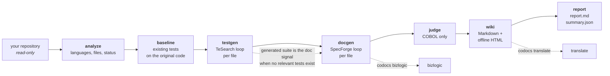

If you ask an LLM to document a file, you get prose that reads well. If you ask it for unit tests, you get tests that look reasonable. Neither comes with evidence. When anything checks them, it is usually a second LLM reading the first one's output. That measures plausibility, not correctness.

[CoDoc](https://github.com/ccsnow127/CoDoc) (`pip install codocs`) replaces that check with execution. It is a command-line tool that generates per-file documentation, per-file unit tests and a repository wiki for Go, Python, Java, C, C++ and COBOL, including repositories that mix them. Every file-level result carries a score that comes from building and running code. It is the engineering counterpart of two of my papers: the doc loop comes from [SpecForge](https://arxiv.org/abs/2610.15708) (NeurIPS 2026) and the test loop from [TeSearch](https://arxiv.org/abs/2610.15964) (NeurIPS 2026 EvoRobust workshop).

## TL;DR

**A doc is a behavioral specification, so CoDoc tests it like one.** It gives the doc, and only the doc, to a separate LLM call that rewrites the file. The rewrite is swapped into the package and the tests that exercise that file are run. The doc's score $$\varphi$$ is the fraction of those tests that pass.

**A test suite is scored by what it would catch.** Failing tests are pruned first. The remaining tests are scored by statement coverage × mutation score on the original code.

**Both artifacts go through a short, bounded loop.** The first round writes a seed. Each later round refines the best artifact so far, using the measured failures. The loop stops early once a threshold is reached and delivers the best round. The default is three rounds.

**CoDoc ships simplified loops, not the paper algorithms.** It drops the search machinery from both papers and keeps their signals.

**Nothing is written into your repository.** Builds and tests run in a mirror under the output directory.

---

## 0 · Plausible is not checked

Generated docs and tests have two typical failure modes:

- **A doc that is fluent but wrong about a detail that matters.** It might say `<` where the code has `<=`, paraphrase an error message, or leave out a side effect. A human reader cannot tell. A downstream agent that trusts the doc will reimplement the bug.
- **A test that passes and asserts almost nothing**, or one that only covers the happy path. Coverage alone rewards both.

Both artifacts have an executable verifier available: the code exists, and in most repositories so do tests. The design question is how to turn them into a score for the _artifact_ rather than for the code.

## 1 · Docs: regenerate the file, run the tests

For each target file, one round works like this:

1. **Write.** The LLM writes a doc in a fixed format with one section per top-level declaration (`VariableDef`, `ClassDef`, `FunctionDef`, `MethodDef`, following RepoAgent's heading contract). Each section gives the exact signatures and declarations, then describes in prose the behavior, edge cases, errors, side effects and return values. It contains no function bodies.
2. **Regenerate.** A separate call at temperature 0 rewrites the file. The generator sees the doc, the package clause, the allowed imports and the signatures declared in the package's _other_ files. It never sees the original source.
3. **Run.** The regenerated file is overlaid into the package. CoDoc then runs the _relevant_ tests: the existing tests that exercise this file and pass on the original code (the baseline).

$$
\varphi \;=\; \frac{\#\,\text{relevant tests passing on the regenerated file}}{\#\,\text{relevant tests}}, \qquad \varphi = 0 \text{ if the regenerated file does not build.}
$$

The doc is the only channel from the original file to the regenerated one, so every failing test traces back to it. Either the doc said something wrong, or it left out something a test checks. This is SpecForge's core observation: a behavioral specification can be tested by building from it.

**When there are no relevant tests**, the signal falls back to the suite CoDoc generated for that file. This is why `testgen` runs before `docgen`. If no generated suite exists either, the only check left is whether the regenerated file compiles, which is a much weaker signal. COBOL programs that cannot be executed (spec programs, or every program when `cobc` is missing) use a static facts signal instead (section 5).

**The refine step** is a single LLM call that sees the original file, the current doc, the regenerated code, $$\varphi$$, the compiler errors or failing tests with their output, and any missing sections. It does two things in one pass:

- **Diagnose:** find each divergence between the regenerated code and the original that explains a failure.
- **Prescribe:** rewrite the doc so that a generator reading only the doc cannot repeat the mistake. The rewrite describes the original's behavior, not the regenerated code.

If a round did not beat the best so far, the next prompt shows it with the instruction "do not repeat that attempt".

## 2 · Tests: prune, then coverage × mutation

For each target file, CoDoc generates one self-contained suite. It runs that suite with the package's own tests hidden, so the suite has to stand on its own.

**Prune.** Failing tests are removed until the suite is green (at most eight pruning runs). All scoring uses the passing subset:

$$
s \;=\; \text{cov} \times \text{mut}
$$

where $$\text{cov}$$ is the statement coverage of the target file and $$\text{mut}$$ is the fraction of valid mutants the suite kills. If mutation is turned off, or no mutant is valid, $$s$$ is coverage alone.

**Mutants are deterministic operators, not LLM output.** Per language, they flip comparisons, logic operators, arithmetic, assignments, increments and boolean literals. COBOL has its own set, which covers arithmetic verbs, `COMPUTE`, `MOVE` literals and `PERFORM` → `CONTINUE`. The default is 20 mutants per file. A mutant on a line that no test covers is only compiled: if it builds, it counts as survived.

**The product is deliberate.** Coverage says a line ran. The mutation score says an assertion would notice if that line changed. A suite that executes everything and asserts nothing gets full coverage and close to zero mutation score.

**Feedback is inline.** The next round sees the current best suite and the target source annotated with its gaps:

```go
// illustrative: the target as the refine prompt shows it
func clamp(v, lo, hi int) int {
	if v < lo { // <-- SURVIVING MUTANT: cmp
		return lo
	}
	if v > hi {
		return hi // <-- NOT COVERED YET
	}
	return v
}
```

Failing tests are marked `// <-- FAILING: <message>`. The instruction is to keep the passing tests, repair the failing ones, and add tests that close the annotated gaps, without padding. When two rounds have the same score, the one with higher coverage wins, then the smaller suite.

## 3 · The loop and the pipeline

Both loops have the same shape:

```text
best = None
for r in 1..rounds:                       # default 3
    a = seed()            if r == 1       # one LLM call (docs: plus one regeneration)
        refine(best)      otherwise       # fed the measured failures
    score = evaluate(a)                   # build + run, no LLM
    best  = argmax(best, a)               # docs: ties keep the earlier round; tests: higher coverage, then the smaller suite
    if score >= threshold: break          # docs 0.9, tests 0.85
deliver best
```

`codocs run` chains the stages (the dotted `translate` and `bizlogic` steps are separate commands):



Every round leaves its evidence on disk. For docs, that is the prompts, the replies, the doc, the regenerated code and `eval.json`. For tests, it is the suite, the green subset and `measure.json`, which lists the uncovered lines and surviving mutants. When a doc scores 0.6, you can open the regenerated code and see which behavior the doc failed to pin down.

## 4 · What is kept from the papers, and what is not

The papers study _search_. CoDoc is a tool that has to finish on a whole repository with a predictable number of LLM calls per file. So it keeps the signals and replaces the search with a single lineage that refines the best round so far.

|                      | Paper search                                                                                                                                           | Kept in CoDoc                                                                                                                                                        |
| :------------------- | :----------------------------------------------------------------------------------------------------------------------------------------------------- | :------------------------------------------------------------------------------------------------------------------------------------------------------------------- |
| **SpecForge** (docs) | multi-frontier tree search: Pareto-guided state selection, dependency-constrained (callee-before-caller) entity selection, error-diversified expansion | regenerate-without-source signal; diagnosis + prescription, merged into one refine call                                                                              |
| **TeSearch** (tests) | quality-diversity evolutionary search: suite size as the behavior descriptor, a learned transition kernel that denoises the LLM                        | measurement: prune failing tests, coverage × mutation on the passing subset, inline gap markers, best-round delivery (ties: higher coverage, then the smaller suite) |

The papers' results were measured with their full algorithms. They do not carry over automatically to these bounded loops, and this post does not claim that they do. The design bet is that most of the value lives in the signal, so the signal is what CoDoc ships.

## 5 · What is in the box

**Six languages**, each with a real runner and a coverage tool:

| Language | Tests run with                             | Coverage                        | Delivered suite                  |
| :------- | :----------------------------------------- | :------------------------------ | :------------------------------- |
| Go       | `go test -overlay`                         | `-cover`                        | `<stem>_codocs_test.go`          |
| Python   | pytest in hardlink farms                   | coverage.py                     | `test_<mod>_codocs.py`           |
| Java     | javac + JUnit Platform, or Maven surefire  | JaCoCo                          | `<Class>CodocsTest.java`         |
| C / C++  | embedded single-header harness             | gcov (GCC or Apple LLVM)        | `<stem>_codocs_test.c` or `.cpp` |
| COBOL    | GnuCOBOL driver + stubs, or batch fixtures | `-ftraceall` statement coverage | `<STEM>_codocs_test.cbt`         |

**COBOL** gets the most machinery, because that is where documentation is scarcest and execution is hardest.

- **Index.** A static index covers programs, copybooks (with `REPLACING`), JCL and PROCs, BMS maps, CSD definitions and CICS/SQL usage. It builds a call graph that resolves dynamic `CALL` targets from literal values.
- **Modes.** Each program is classified into one of three modes:
  - _Unit_ programs get a generated driver and stubs that print `TEST <id> PASS/FAIL`.
  - _Batch_ programs get golden files: DD fixtures, expected output files, stdout and the return code. Records are written field by field, including COMP-3 and zoned decimals.
  - _Spec_ programs (CICS, DB2, DL/I or screen I/O) are not executed. They get a structured test specification instead.
- **Facts signal.** Docs for programs that cannot run are scored statically. CoDoc extracts facts from the original and from the regenerated program and compares them: $$\varphi = J(\text{scored}) \times J(\text{structural})$$, where $$J$$ is Jaccard similarity. Structural facts are the program id, entries, files, copybooks, data and paragraphs. Scored facts include `PERFORM`s, calls, SQL, CICS commands, conditions and moves. If the original compiles, a regeneration that does not compile scores 0.
- **Doc judge.** An LLM judge checks each doc claim by claim against the source. It also checks coverage against a checklist derived from the index (not from the LLM), and it runs a deterministic name check. The judge's evidence quotes are verified against the source. `--calibrate` injects five kinds of errors into docs to measure how sensitive and stable the judge is. By default the judge uses a different model (`gpt-5.5`) from the generator.

**Repository wiki.** The wiki is built on a modified fork of RepoWiki, extended with a deepdoc pipeline (planner, generator, Mermaid validation and repair) that is fed the loop-checked file docs. It produces overview, architecture and subsystem pages. Mermaid blocks are validated, and any that fail go through a repair pass. The output is Markdown plus one self-contained HTML file, fully offline once the Mermaid bundle is installed (`./install.sh` downloads it; otherwise the HTML loads Mermaid from a CDN).

**Translation.** `codocs translate` translates a wiki while preserving its structure. Code, inline code and placeholders are protected. Mermaid labels are translated separately and re-validated. A page that fails validation stays in the source language and is listed in the output.

**Business logic.** `codocs bizlogic` works in stages:

1. Build a cross-language function graph. Go↔C via cgo and COBOL `CALL` → C both count as edges.
2. Group functions into hierarchical clusters.
3. Pick entry points.
4. Run random walks from them and deduplicate the walks into trajectories.
5. Make one LLM summary per trajectory.

The diagrams are deterministic Mermaid. The analysis is domain-neutral by default. `--domain-profile` adds the vocabulary of a specific domain, and the built-in example, `3gpp-5gc`, uses only public 3GPP terms.

**Operational details.**

- **Caching and resume.** Every valid LLM reply is cached in SQLite (`~/.codocs/cache.db`). Finished files are skipped on re-run and writes are atomic, so an interrupted run resumes where it stopped.
- **Missing toolchains.** A file whose toolchain is missing gets status `no-toolchain` and no further LLM calls. The exception is COBOL docs without `cobc`, which are scored by the static facts signal.
- **LLM endpoints.** Any OpenAI-compatible API works.

## 6 · Try it

You need a model endpoint, and a toolchain for each language you want to process. The fastest check is a small Go library:

```bash
pip install codocs
export OPENAI_API_KEY=sk-...
# export OPENAI_BASE_URL=https://your-endpoint/v1    # any OpenAI-compatible API

git clone https://github.com/dustin/go-humanize
codocs analyze go-humanize                        # no LLM, no tests run: languages, files, file status
codocs run go-humanize -o out/gh --max-files 3    # baseline → testgen → docgen → wiki → report
```

Then look at:

- `out/gh/report.md`: $$\varphi$$ per round for each doc, and score, coverage and mutation score per round for each suite.
- `out/gh/docs/markdown_docs/`: the delivered docs. go-humanize keeps almost all files in its root package; a subpackage's docs go to `out/gh/docs/<pkg>/markdown_docs/`.
- `out/gh/tests/_root/`: the delivered suites (`_root` is the root package). `codocs testrun out/gh` re-runs them on the original code without the LLM.
- `out/gh/docgen/_root/<stem>/round_<r>/`: `doc.md`, `code.go` (the regenerated file as it was run) and `eval.json` ($$\varphi$$, the failing tests and their output). The prompts and raw replies sit next to them.
- `out/gh/wiki/`: the wiki, including the offline HTML.

`-m` picks the model (default `gpt-5.4`, or `CODOCS_MODEL`; aliases `gpt`, `gpt-mini` and `judge`); any other name is passed to the endpoint unchanged. `--judge-model` (default `gpt-5.5`, or `CODOCS_JUDGE_MODEL`) sets the COBOL doc judge. `--codegen-model` (or `CODOCS_CODEGEN_MODEL`; default: the `-m` model) sets a separate model for regenerating COBOL programs from their docs; that step benefits from the strongest model you have. `--subtree`, `--files` and `--max-files` limit how much a run touches. `analyze`, `wiki --plan-only`, `bizlogic --plan-only`, `testrun` and `report` need no API key.

To get every toolchain at once (Go, JDK 21 + Maven, GnuCOBOL 3.2, pytest + coverage, GCC on Linux) and the offline Mermaid bundle, use the conda setup:

```bash
git clone https://github.com/ccsnow127/CoDoc && cd CoDoc
./install.sh              # creates the conda env "codocs"
conda activate codocs
```

## 7 · Limits

- **$$\varphi$$ is only as strong as the tests.** Behavior that no test checks is unconstrained. A doc can omit it and still score 1.0. Falling back to generated suites helps but is weaker, because the same kind of model wrote them. A compile-only fallback says little.
- **Regenerability is a proxy.** It measures whether a doc is complete and precise enough to rebuild the file. It does not measure whether a human finds the doc readable. Outside COBOL, there is no judge pass.
- **Java:** Maven modules and plain javac only. Gradle builds are reported as `unsupported-build`.
- **COBOL:** CICS, DB2 and DL/I programs are not executed. Their docs are scored by structural agreement, not behavior.
- **C/C++:** existing test programs must be sources with a `main`. gtest, Catch2 and similar frameworks run only through `--test-cmd`.
- **Cost:** every doc round is two LLM calls plus a test run, and mutation multiplies the number of test runs. Start with `--max-files` and `--mutants`.

## Links

- Code: [github.com/ccsnow127/CoDoc](https://github.com/ccsnow127/CoDoc) (MIT)
- Package: [pypi.org/project/codocs](https://pypi.org/project/codocs/)
- SpecForge: [arXiv:2610.15708](https://arxiv.org/abs/2610.15708), [OpenReview](https://openreview.net/forum?id=yMLqe1DovZ), [code](https://github.com/ccsnow127/SpecForge)
- TeSearch: [arXiv:2610.15964](https://arxiv.org/abs/2610.15964), [code](https://github.com/ccsnow127/TeSearch)

> A doc you can rebuild the code from, and a suite that notices when the code changes: both are claims you can check by running something, so CoDoc runs it.

## Citation

If you found this useful, please cite this post as:

> Cheng, Yutong. "CoDoc: Documentation and Unit Tests, Verified by Execution." Blog post, October 2026. https://ccsnow127.github.io/blog/2026/codoc/



```bibtex
@misc{cheng2026codoc,
  author       = {Cheng, Yutong},
  title        = {{CoDoc}: Documentation and Unit Tests, Verified by Execution},
  year         = {2026},
  month        = oct,
  howpublished = {\url{https://ccsnow127.github.io/blog/2026/codoc/}},
  note         = {Blog post}
}
```



and the papers behind the two loops:



```bibtex
@inproceedings{cheng2026specforge,
  title     = {{SpecForge}: Recursive Self-Improvement for Coding Agents via Behavioral Specifications},
  author    = {Cheng, Yutong and Chen, Haifeng and Gao, Peng and Cheng, Wei},
  booktitle = {Advances in Neural Information Processing Systems (NeurIPS)},
  year      = {2026},
  eprint    = {2610.15708},
  archivePrefix = {arXiv},
  url       = {https://arxiv.org/abs/2610.15708}
}

@inproceedings{cheng2026tesearch,
  title     = {Small but Mighty: Test Suites as Improvement Signals for Self-Evolving Agents},
  author    = {Cheng, Yutong and Cheng, Wei and Yu, Wenchao and Zhou, Dawei and Chen, Haifeng},
  booktitle = {NeurIPS 2026 Workshop on Self-Evolving Diversity-Driven Search for Robust AI Systems (EvoRobust)},
  year      = {2026},
  eprint    = {2610.15964},
  archivePrefix = {arXiv},
  url       = {https://arxiv.org/abs/2610.15964}
}
```


